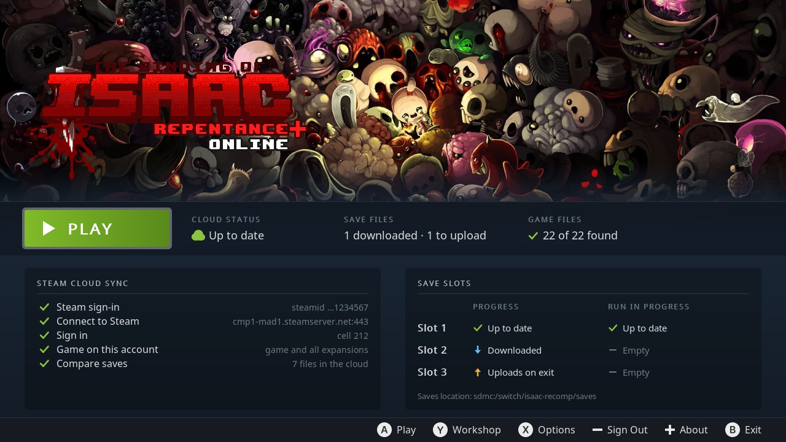
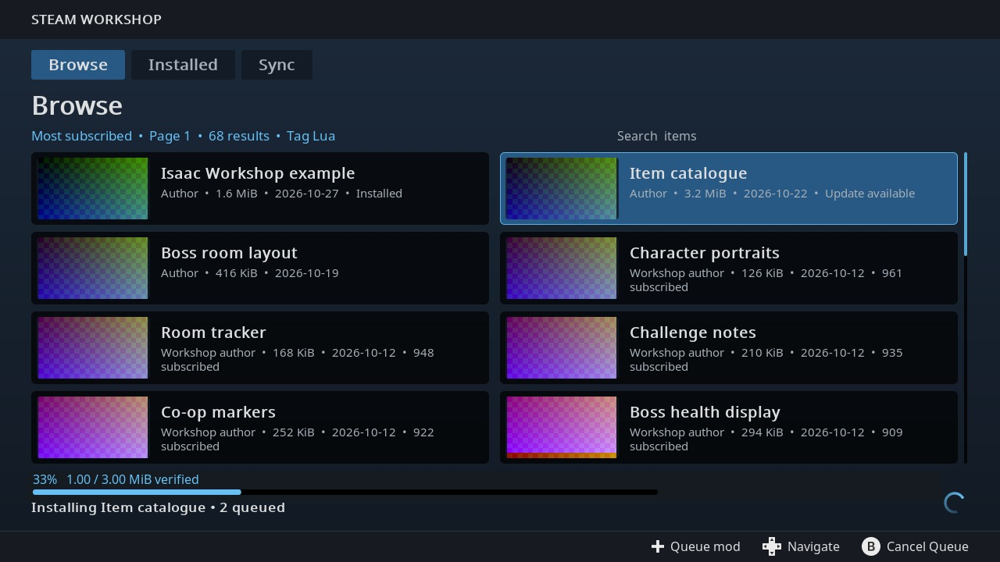

# IsaacNX+

Play **The Binding of Isaac: Repentance+** on a homebrew Nintendo Switch, with performance settings in the launcher and Steam Workshop mods you can manage right on the console.

IsaacNX+ is a fork of **isaac-switch-native** for the PC release **v1.9.7.19**. The project was built with AI assistance. Earlier versions were tested on a real Switch, including downloading and installing Workshop mods. [Original Switch port](https://github.com/antoniotorres02/isaac-switch-native)

> **Bring your own game.** This repository contains source code, documentation, and interface screenshots. It provides no game files, executables, or prebuilt game packages. Build from your own purchased copy and a compatible DRM-free executable.
>
> **Unofficial project.** Steam, Valve, Nintendo, and Nicalis did not develop, sponsor, or endorse this fork.

## Highlights

- **Performance settings.** Press **X** on the launcher to change graphics settings that Isaac usually keeps in configuration files. The performance preset uses 1× render scale and turns off bloom, shockwaves, water light patterns, and room color effects. Lighting and water surfaces stay on. Fullscreen starts off for a wider view in fresh setups. Choose **30 FPS** under **Frame skip** to give crowded rooms more time per game update. **Skip water reflections** is an experimental, opt-in setting for flooded rooms. [Game Options](PLAYING.md#game-options)
- **Workshop on Switch.** Browse, search, and filter mods in a two-column grid with cached pages and animated previews. Open a mod to read its description, see images and GIFs, and review its dependencies. Download, update, enable, disable, or remove local mods without a PC once the build is installed. [Workshop controls](PLAYING.md#steam-workshop-on-switch)
- **Optional subscription sync.** **Sync Steam Mods** shows the differences between your Steam subscriptions and the mods on your SD card. Review the changes, pick the ones you want, then confirm. Installing or removing a local mod leaves your Steam subscriptions alone.
- **Steam Cloud saves.** Use the original port’s Steam QR sign-in to sync saves. You can also build without Steam features and keep playing with local saves and manually copied mods. [Steam Cloud guide](STEAM-CLOUD.md)
- **Easier setup.** The included Isaac Switch Builder guides you through building the game and copying it to your SD card. Your build uses the Isaac icon from your own executable in the Homebrew Menu. [Isaac Switch Builder guide](host/builder/README.md)

| Launcher | Workshop install queue |
| --- | --- |
|  |  |

Interface previews rendered on a PC. The in-game screenshots below are from earlier Switch builds.

## Build and play

You need a Switch that can already run homebrew, an SD card, a computer with [Docker](https://docs.docker.com/get-docker/) and Python 3, and your own purchased copy of **Isaac with Repentance+ v1.9.7.19**. The build also requires a compatible **DRM-free `isaac-ng.exe`**. If you already own the game on Steam, setup is straightforward once you have the supported executable. The builder checks that the executable matches the required version.

> **Back up your saves before installing, importing, or syncing them.** I’m not responsible for lost progress.

1. Download or clone this repository and open its folder in a terminal. On Linux, start the included builder with the command below. See the [Builder guide](host/builder/README.md) for Windows, where you can use `py -3` in place of `python3`.
2. In the builder, select your game folder and compatible executable. Choose a work folder, keep **Include Steam Workshop and Steam Cloud** enabled if you want Steam features, and start the build. Turn that checkbox off to make a build without Steam support.
3. Use the builder’s **Copy to SD** option, or copy the resulting `sd-card` folder’s contents to the root of your SD card. Run the generated installer for a HOME Menu build, or open the NRO from the Homebrew Menu in Application mode. [SD card setup and controls](PLAYING.md#installing-on-the-switch)

```sh
python3 host/builder/isaac_switch_builder.py gui --steam
```

For a build without the window, run this from the repository folder with your own paths:

```sh
python3 host/builder/isaac_switch_builder.py build \
  --folder ./build/isaacnx \
  --game "/path/to/The Binding of Isaac Rebirth" \
  --exe "/path/to/isaac-ng.unpacked.exe" \
  --steam --format nro
```

Omit `--steam` to build without Workshop and Cloud. The builder uses the slim tools image, about **1 GB**, and builds it from this checkout on first use. Allow at least **4 GiB of build memory** and **6 GiB of free disk** for the work folder. The example selects a homebrew NRO. Use `--format nsp` for the upstream HOME Menu installer workflow. [Docker-only guide](GUIDE.md) · [Manual build guide](BUILDING.md)

Your game executable and data stay on your computer. Keep the NRO and the generated game files for personal use. This repository contains source code and documentation.

## On the Switch

| Control | What it opens |
| --- | --- |
| **A** | Play |
| **Y** | Workshop in Steam-enabled builds |
| **X** | Game Options. Hold up or down to scroll. |
| **−** | Steam QR sign-in or sign out |
| **+** | About |
| **B** | Exit |

Press **+** on a Browse card to install it and stay on the grid. Keep browsing and press **+** on other cards to queue them. Downloads run one at a time, with progress shown on the grid. Open **Sync** to review and confirm changes to Steam subscriptions.

<details>
<summary>More screenshots</summary>

- [Repentance+ title screen](docs/screenshots/repentance-plus-title-screen.jpg)
- [Game Options](docs/screenshots/options-v19719.jpg)
- [About](docs/screenshots/about-v19719.jpg)
- [Workshop item details](docs/screenshots/workshop-details-v19719.jpg)
- [Manual Workshop subscription sync](docs/screenshots/workshop-sync-v19719.jpg)
- [In-game Mods menu](docs/screenshots/in-game-mod-menu.jpg)
- [External Item Descriptions in a run](docs/screenshots/external-item-descriptions.jpg)
- [Default wide view](docs/screenshots/gameplay-wide-view.jpg) · [Fullscreen zoomed view](docs/screenshots/gameplay-fullscreen-zoom.jpg)

</details>

The launcher uses the logo from your game files and the official Steam library banner when available. You can also supply Steam’s Motiva Sans font. [Launcher artwork and font](PLAYING.md#launcher-artwork-and-font)

## Known issues

- With mods enabled, the game can take a while to start. The screen can stay black while it loads.
- Some boss-ending cutscenes still play at just a few frames per second on Switch.
- Vade Retro room clear in Greedier still needs a Switch test on v1.9.7.19.
- Music can stop in a room. Moving to another room restores it.
- Online co-op is unavailable in this DRM-free build. Workshop and Cloud saves are available in Steam-enabled builds.

For help with saves or mods, see the [Playing guide](PLAYING.md), the [Steam Cloud guide](STEAM-CLOUD.md), or the [Workshop guide](STEAM-WORKSHOP.md). If you report a problem, include your Switch model, game version, and what you were doing when it happened.

## Credits and license

- **Antonio Javier Torres Bordón (antoniotorres02) and Don Claudio** for the original Switch port and the foundation for IsaacNX+. The original project also provides Isaac Switch Builder. [isaac-switch-native](https://github.com/antoniotorres02/isaac-switch-native)
- **chiikabu** for the original browser recompilation and **xreamm** for the upstream checkout used by the Switch port. [Original the-browsing-of-isaac](https://github.com/chiikabu/the-browsing-of-isaac) · [Pinned upstream project](https://github.com/xreamm1/the-browsing-of-isaac)
- **Edmund McMillen and Nicalis** for *The Binding of Isaac: Repentance+*. The game and its artwork belong to their respective owners.
- **Gioele Casazza** for the launcher’s Switch button graphics, licensed under CC BY 4.0. [Icon pack and attribution](host/launcher/icons/CREDITS.md)
- **Bane Sullivan** for the README writing guide. [How to write a good README](https://github.com/banesullivan/README)

IsaacNX+ uses the original project’s **GNU General Public License v3.0 or later**. The license covers the project’s code. [LICENSE](LICENSE)
